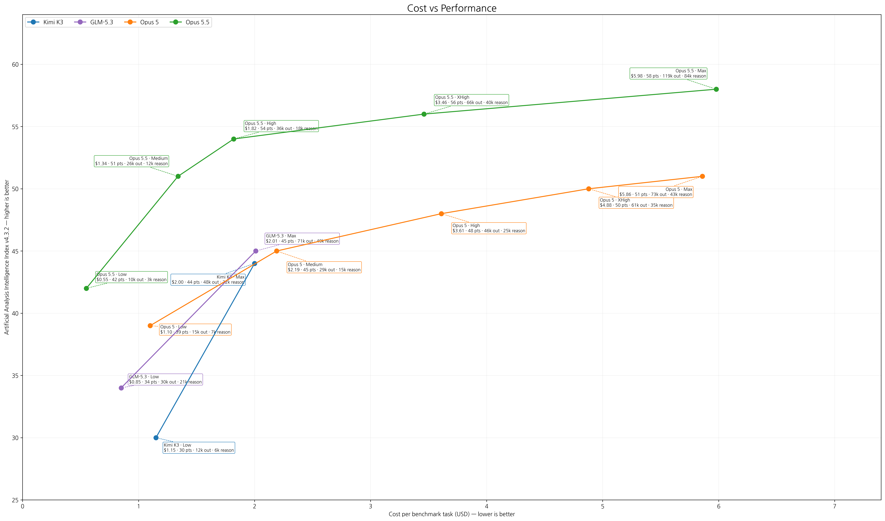
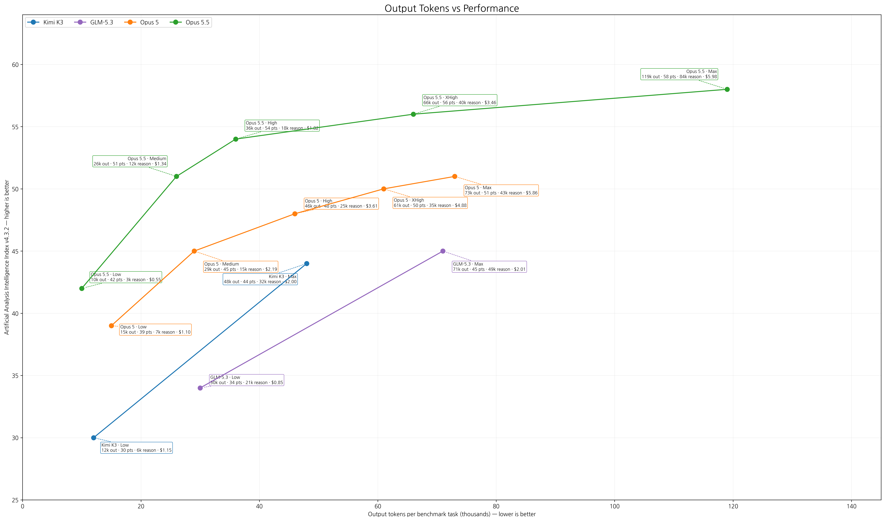
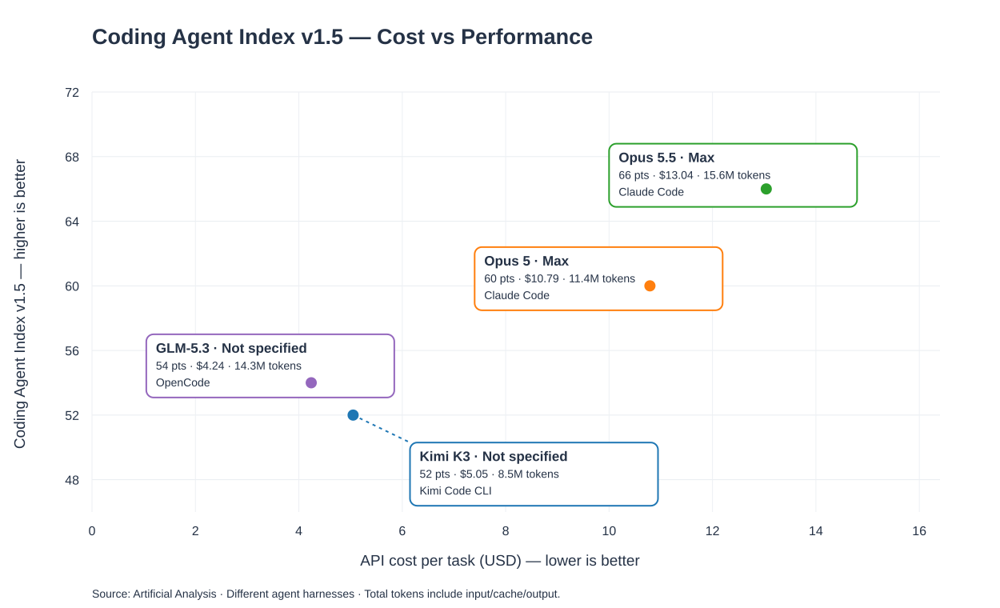
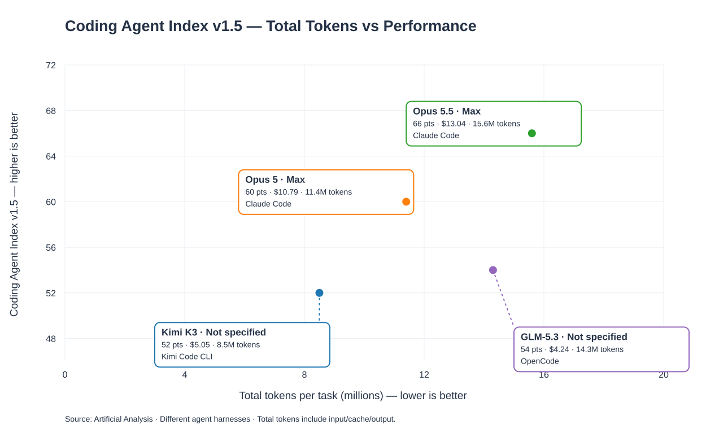

# Kimi K3 · GLM-5.3 · Claude Opus 5 · Opus 5.5: Effort별 성능·비용 비교

## 그래프 출처 / 기준

- **출처:** [Artificial Analysis](https://artificialanalysis.ai/)
- **성능:** Artificial Analysis Intelligence Index v4.3.2
- **벤치마크:** AI 에이전트(30%)·코딩(20%)·과학적 추론(20%)·일반 지능(30%)의 **10개 평가** 종합.
- kimi는 하네스를 kimi code cli를 사용하였다. 하네스를 claude로 통일하고 effort별로 바꿔가며 실험한 결과는 찾지 못하였다. kimi 자체 조사에 의하면 claude 하네스를 쓸 시 성능이 1.1% 올라간다.
- **비용:** 동일 벤치마크 작업당 가중평균 비용(USD).
- **토큰:** 벤치마크 작업당 출력 토큰과 그중 추론 토큰. 추론 토큰을 출력 토큰에 다시 더하지 않음.
- **Effort:** 공개된 Low / Medium / High / XHigh / Max 등 모델별 추론 강도. 같은 이름이라도 모델 간 계산량이 동일하다는 뜻은 아님.
- **주의:** KIMI 비용은 문 샷 공식 api 기준이며 OpenRouter 실제 청구 비용과는 다르다. OpenRouter는 open weight model을 사설로 서빙하는 다수 업체들을 연결하여 서비스 하며 이 사설 업체들 중에는 현재 43%까지 공격적으로 할인하는 업체도 존재한다.
- **조회 기준:** 2026-10-15

## Kimi 비용 출처 교차검증

- [Moonshot 공식 API 가격표](https://platform.kimi.ai/zh-hans): K3 입력 **$3.00/100만 토큰**, 출력 **$15.00/100만 토큰**, 캐시 적중 **$0.30/100만 토큰**.
- [Artificial Analysis Kimi K3 Max](https://artificialanalysis.ai/models/kimi-k3/): **“based on Kimi's API”**라고 명시하고 동일한 **$3/$15** 단가 및 **작업당 $2.00**를 제시한다. 따라서 그래프의 Kimi 비용은 Moonshot 공식 API 단가에 기반한 Artificial Analysis 작업당 비용이라는 점이 확인된다.
- [Artificial Analysis Kimi K3 Low/Max 비교](https://artificialanalysis.ai/models/comparisons/kimi-k3-low-vs-kimi-k3): Low **$1.15**, Max **$2.00** 작업당 비용을 제시한다.
- [OpenRouter Kimi K3](https://openrouter.ai/moonshotai/kimi-k3): 특정 공급자 기준 입력 **$1.70**, 출력 **$8.50**, 캐시 읽기 **$0.17**이 표시된 사례는 Moonshot 공식 단가 대비 **43.3% 저렴**하다. 이는 모든 공급자에 대한 일률적 할인이나 실제 청구액 보장이 아니다.

## 원본

- [Artificial Analysis Intelligence Index](https://artificialanalysis.ai/evaluations/artificial-analysis-intelligence-index)
- [Artificial Analysis 평가 방법론](https://artificialanalysis.ai/methodology/intelligence-benchmarking)
- [OpenRouter Kimi K3 공급자·가격](https://openrouter.ai/moonshotai/kimi-k3)

## 가로축을 토큰양으로 할 경우

**참고:** Opus 5.5는 이전 Opus 5보다 토큰 가격이 싸졌기 때문에, 달러 비용이 아니라 사용한 토큰양을 가로축으로 놓으면 같은 비용 그래프에서 볼 때보다 토큰 사용량이 상대적으로 더 크게 보인다.

## 다른 벤치마크: Coding Agent Index v1.5

기존 **Intelligence Index**와 별도로, 코딩 에이전트 성능을 비교한다. 모델뿐 아니라 **에이전트 실행 환경(harness)** 도 결과에 영향을 준다. Opus 5·5.5는 Claude Code, GLM-5.3은 OpenCode, Kimi K3는 Kimi Code CLI에서 평가되었다.

### 가로축: 작업당 API 비용

### 가로축: 작업당 총토큰

**주의:** 여기의 총토큰은 입력·캐시·출력 토큰을 포함하며, 앞의 Intelligence Index 그래프에서 사용한 **출력 토큰**과 다르다. 공개된 이 비교에서는 Opus 5와 5.5는 Max 설정이지만, Kimi K3와 GLM-5.3의 Effort는 별도로 표기되지 않는다. 없는 Effort별 수치를 추정해 넣지 않았다.

- [데이터 CSV](coding_agent_index_v15_four_models.csv)
- [Artificial Analysis — Claude Code vs OpenCode](https://artificialanalysis.ai/agents/coding-agents/comparisons/claude-code-vs-opencode)
- [Artificial Analysis — Claude Code vs Kimi Code CLI](https://artificialanalysis.ai/agents/coding-agents/comparisons/claude-code-vs-kimi-code-cli)
