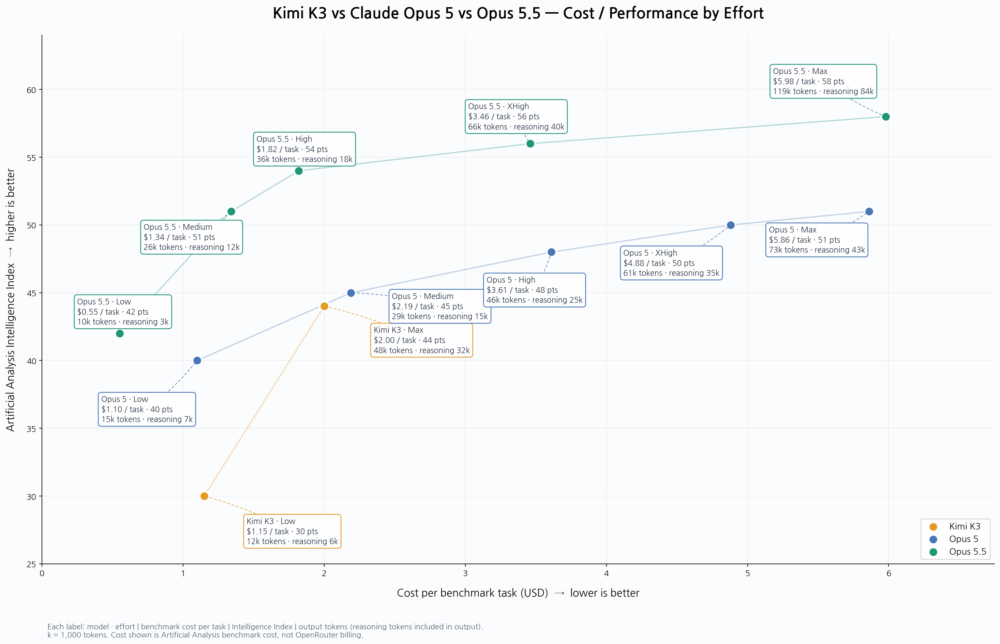

# Kimi K3 · Claude Opus 5 · Opus 5.5: Effort별 성능·비용 비교

## 그래프 출처 / 기준

- **출처:** [Artificial Analysis](https://artificialanalysis.ai/)
- **성능:** Artificial Analysis Intelligence Index v4.3.2
- **벤치마크:** AI 에이전트(30%)·코딩(20%)·과학적 추론(20%)·일반 지능(30%)의 **10개 평가** 종합.
- **비용:** 동일 벤치마크 작업당 가중평균 비용(USD). **OpenRouter 청구액이 아님.**
- **토큰:** 벤치마크 작업당 출력 토큰과 그중 추론 토큰. 추론 토큰을 출력 토큰에 다시 더하지 않음.
- **Effort:** 공개된 Low / Medium / High / XHigh / Max 등 모델별 추론 강도. 같은 이름이라도 모델 간 계산량이 동일하다는 뜻은 아님.
- **Kimi 가격 주의:** 그래프의 Kimi 비용은 Artificial Analysis 평가에 사용된 가격 기준이며, **Moonshot 공식 API 가격과의 정확한 일치 여부는 별도 확인이 필요**하다. OpenRouter는 Kimi 오픈웨이트 모델을 독립적으로 서빙하는 복수 공급자를 연결하며, 특정 공급자는 기준 가격 대비 약 43% 낮은 입력·출력 단가를 제시한 사례가 있다. **43%는 모든 공급자·모든 시점에 적용되는 고정 할인율이 아니다.** 실제 청구액은 선택 공급자, 입력·출력·캐시 구성에 따라 달라진다.
- **조회 기준:** 2026-10-15

## 검증상 주의

이 저장소의 그래프 및 CSV에 적힌 **개별 Effort별 점수·비용·토큰 수치는 이전 대화에서 작성된 값**이다. 이번 작업에서 Artificial Analysis 공식 방법론과 지표 정의는 확인했지만 **각 데이터 행을 원본 표와 일대일 재검증하지 못했다.** 따라서 이를 독립 검증 완료된 원시 측정값으로 인용하지 말 것.

## 원본

- [Artificial Analysis Intelligence Index](https://artificialanalysis.ai/evaluations/artificial-analysis-intelligence-index)
- [Artificial Analysis 평가 방법론](https://artificialanalysis.ai/methodology/intelligence-benchmarking)
- [OpenRouter Kimi K3 공급자·가격](https://openrouter.ai/moonshotai/kimi-k3)
